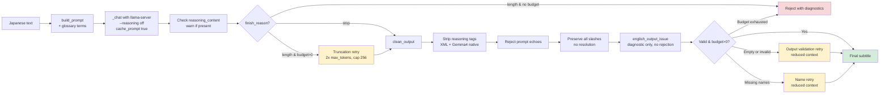

# Requirements

### Overview & Goals

This plan addresses the confirmed defects in the Gemma 4 translation pipeline, focusing on:
1. **Slash-separated translation corruption** - `resolve_slash_alternatives()` deletes meaningful words like "yes/no" → "yes"
2. **Truncated translation handling** - `finish_reason="length"` detected but no retry
3. **Native Gemma 4 channel-marker leakage** - incomplete protection against reasoning delimiters
4. **Orphan reasoning tags** - incomplete handling of unclosed blocks
5. **Verification of reasoning mode disabled** - confirm backend operates correctly

### Scope

**In Scope:**
- Fix `resolve_slash_alternatives()` in `gemma4.py` to preserve all ambiguous slashes
- Fix `has_slash_alternatives()` in `subtitle_clean.py` to reduce false positives
- Add truncation retry logic integrated with existing fallback and bounded retry budget
- Strengthen channel marker and reasoning tag protection based on actual GGUF template
- Add comprehensive regression tests
- Verify reasoning mode is truly disabled via actual backend behavior
- Run real inference tests with Gemma 4 E4B model

**Out of Scope:**
- Rewriting the application architecture
- Changing ASR pipeline
- Modifying GUI or video playback
- Changing sampling parameters without evidence
- Switching KV cache type
- Disabling flash attention without evidence

### User Stories

1. As a viewer, I want slash-separated expressions like "yes/no", "24/7", "input/output" preserved in translations so the meaning isn't corrupted.
2. As a viewer, I want complete translations even when the model initially truncates output.
3. As a viewer, I want no reasoning text or internal model markers appearing in subtitles.
4. As a developer, I want reliable tests that catch regression in these areas.

### Acceptance Criteria

1. `resolve_slash_alternatives("yes/no")` returns `"yes/no"` (preserved)
2. `resolve_slash_alternatives("Hello/Hi")` returns `"Hello/Hi"` (preserved - ambiguous, not resolved)
3. Truncated responses trigger at most one retry within shared bounded retry budget
4. No reasoning tags or channel markers appear in final subtitle output
5. All existing tests pass
6. New regression tests cover all identified cases
7. Real inference tests verify actual model behavior vs mocked tests

# Technical Design

### Current Implementation

**Files under investigation:**
- `src/auto_translate/translate/gemma4.py` (586 lines) - translation logic
- `src/auto_translate/subtitle_clean.py` (314 lines) - cleanup functions
- `src/auto_translate/llama_server.py` (256 lines) - server integration
- `tests/test_slash_alternatives.py` (220 lines) - existing slash tests
- `tests/test_prompt_leakage.py` (585 lines) - prompt leakage tests
- `tests/test_gemma4_hardening.py` (158 lines) - hardening tests

**Already implemented (left untouched):**
- Special token flood detection (`has_special_token_flood()`)
- Reasoning mode removal (no `--reasoning` flags)
- Prompt echo rejection (`looks_like_prompt_echo()`)
- finish_reason tracking in `_chat()`
- Per-request diagnostics
- Flash attention enabled (`-fa on`)
- FP16 KV cache (default)
- Prompt caching (`cache_prompt=True`)

### Key Decisions

1. **Slash handling**: Preserve all ambiguous slashes. Word similarity and whitelists are insufficient to determine whether a slash represents genuine speech or translation alternatives. Only resolve when there is reliable evidence of model-generated alternatives (e.g., clear retry with stricter formatting instructions). If ambiguity remains, preserve the original rather than deleting content. Never silently change meaning.

2. **Truncation retry**: Integrate with existing translation fallback logic. Enforce a shared, bounded retry budget (max 1 retry for truncation, max 1 retry for output validation) to prevent excessive inference calls. Reject responses that remain truncated after retry. Preserve valid short dialogue like "Really?", "Wait!", "Okay", "No way".

3. **Channel markers**: Inspect the actual installed GGUF chat template and llama.cpp implementation to identify verified native markers. Do not assume proposed syntax. Handle verified markers, unclosed reasoning blocks, and malformed API responses safely.

4. **Reasoning verification**: Verify actual backend behavior by inspecting `content`, `reasoning_content`, and supported template parameters. Do not reintroduce thinking-mode settings. Preserve existing reasoning-leakage guards as output safety protections.

### Proposed Changes

#### 1. Fix `resolve_slash_alternatives()` (gemma4.py:176-204)

**Current problem:** Blindly keeps first word in `word/word` patterns, corrupting:
- `yes/no` → `yes`
- `on/off` → `on`
- `and/or` → `and`
- `input/output` → `input`
- `24/7` → `24`

**New approach:** Preserve all ambiguous slashes. The function should be conservative:
- Preserve URLs (http://, https://)
- Preserve dates (MM/DD, DD/MM/YYYY)
- Preserve fractions (1/2, 3/4)
- Preserve all `word/word` patterns where meaning is ambiguous (yes/no, on/off, and/or, Hello/Hi, good/great, etc.)
- Only resolve when there is reliable evidence of model-generated multiple translation output (retry with stricter formatting instructions)
- If ambiguity remains, preserve the original rather than deleting content
- Never silently change meaning by choosing one side over the other

#### 2. Fix `has_slash_alternatives()` (subtitle_clean.py:249-268)

**Current problem:** Same pattern as resolver, causes false positives for legitimate content.

**New approach:** Align with the new resolver logic - do not flag legitimate slash usage. Only flag patterns when there is reliable evidence they represent translation alternatives, not content.

#### 3. Add Truncation Retry (gemma4.py:360-428)

**Current state:** `finish_reason="length"` is logged but content is still returned.

**New approach:** Integrate with existing translation fallback logic with a shared bounded retry budget:
- Detect `finish_reason="length"` in `_chat()`
- Enforce shared retry budget: max 1 retry for truncation + max 1 retry for output validation = max 2 total retries per translation
- Retry once with `max_tokens * 2` (capped at 256)
- Reject output if still truncated after retry
- Record retry in diagnostics (record_event with truncation_retry)
- Preserve valid short dialogue: "Really?", "Wait!", "Okay", "No way" - do not reject based on punctuation
- Do not rely solely on punctuation to determine completeness

#### 4. Strengthen Channel Marker Protection (gemma4.py:45-53)

**Current state:** Handles `<think>`, `<thinking>`, `<reasoning>` tags.

**New approach:** Inspect actual installed GGUF chat template and llama.cpp implementation:
- Read the GGUF file's chat template to identify actual native channel delimiters
- Do not assume proposed token syntax like `<|thought|>` without verification
- Extend `_REASONING_BLOCK` and `_REASONING_OPEN` patterns only for verified markers
- Handle malformed/unclosed blocks more robustly
- Reject responses with reasoning content but no translation
- Handle malformed API responses safely

#### 5. Verify Reasoning Content Field (llama_server.py:212-225)

**Current state:** Returns full payload but doesn't check `reasoning_content`.

**New approach:** Verify actual backend behavior:
- Extract and log `reasoning_content` field if present
- Inspect `content` field for any reasoning text
- Check supported template parameters in llama.cpp
- Do not reintroduce thinking-mode settings
- Preserve existing reasoning-leakage guards as output safety protections
- Use as additional validation that reasoning is truly off

### File Structure

**Modified files:**
- `src/auto_translate/translate/gemma4.py` - slash handling, truncation retry, channel markers
- `src/auto_translate/subtitle_clean.py` - slash detection alignment
- `src/auto_translate/llama_server.py` - reasoning_content extraction

**Modified test files:**
- `tests/test_slash_alternatives.py` - update expectations, add preservation tests
- `tests/test_prompt_leakage.py` - add channel marker tests
- `tests/test_gemma4_hardening.py` - add truncation and reasoning verification tests

**New test file:**
- `tests/test_truncation_handling.py` - truncation retry tests

### Architecture Diagram

**Shared retry budget:** max 2 additional inference requests per utterance total. At most 1 truncation retry (`_MAX_TRUNCATION_RETRIES=1`), remaining budget shared among output validation retries (empty output, output issues, missing names). All retry paths decrement the same `retries_left` counter (`_MAX_RETRIES=2`).

### Risks

1. **Over-preserving slashes**: The conservative approach preserves all ambiguous slashes. This is intentional - better to preserve than to delete meaning. Mitigation: the `has_slash_alternatives()` check in `english_output_issue()` remains as a diagnostic flag, not a rejection criterion.

2. **Truncation retry latency**: Doubling max_tokens on retry adds latency. Mitigation: cap at 256 tokens, limit to one retry within shared budget.

3. **Channel marker false positives**: Legitimate dialogue containing words like "thinking" might be affected. Mitigation: only match actual token patterns from verified GGUF template, not plain text.

4. **Retry budget exhaustion**: Shared retry budget prevents excessive inference calls but might reject valid translations under poor conditions. Mitigation: clear diagnostics recording why each retry occurred and what the final outcome was.

# Testing

### Validation Approach

Run the complete existing test suite after each change to ensure no regressions. Add targeted regression tests for each fix.

### Key Scenarios

#### Slash Preservation Tests
- `yes/no` → preserved as `yes/no`
- `on/off` → preserved as `on/off`
- `24/7` → preserved as `24/7`
- `input/output` → preserved as `input/output`
- `and/or` → preserved as `and/or`
- `Hello/Hi` → preserved as `Hello/Hi` (ambiguous, not resolved)
- `good/great` → preserved as `good/great` (ambiguous, not resolved)
- URLs preserved: `https://example.com`
- Dates preserved: `12/25/2024`
- Fractions preserved: `1/2`

#### Truncation Tests
- `finish_reason="length"` triggers retry
- Retry uses doubled max_tokens (capped at 256)
- Second truncation rejects output
- Short valid phrases not rejected: `Really?`, `Wait!`, `Okay`, `No way`

#### Channel Marker Tests
- Normal English translation passes
- Channel markers without valid translation rejected
- Reasoning preceding translation stripped
- Unclosed reasoning blocks rejected
- Unexpected marker sequences handled
- Malformed response objects rejected
- Correctly separated response content preserved

#### Reasoning Verification Tests
- `reasoning_content` field is empty or absent
- No reasoning text in `content` field
- API response structure validated

### Edge Cases

- Empty responses
- Whitespace-only responses
- Japanese script in output (rejected)
- Special token floods (already tested)
- Prompt echoes (already tested)
- Glossary leakage (already tested)
- Profanity preservation
- Slang preservation
- Nickname preservation
- Emotional expressions

### Test Changes

1. **Update** `test_slash_alternatives.py`:
   - Change expectations: all ambiguous slashes should be preserved
   - `Hello/Hi` → preserved as `Hello/Hi` (not resolved)
   - `good/great` → preserved as `good/great` (not resolved)
   - Add tests for legitimate slash patterns
   - Add tests for URL, date, fraction preservation

2. **Update** `test_prompt_leakage.py`:
   - Add channel marker tests
   - Add unclosed reasoning block tests

3. **Update** `test_gemma4_hardening.py`:
   - Add truncation retry tests
   - Add reasoning_content verification

4. **Create** `test_truncation_handling.py`:
   - Mock truncation scenarios
   - Test retry logic
   - Test rejection after failed retry

### Real Inference Testing

Run the actual Gemma 4 E4B model through llama-server to verify:
- Normal translations of representative Japanese utterances
- Changing context (different dialogue history)
- Prompt caching behavior (identical prompts produce stable results)
- Reasoning-disabled behavior (no reasoning content in output)
- Truncation recovery (if truncation occurs, retry works)
- Subtitle output contains only intended English translations
- Clearly distinguish real model tests from mocked tests in reports
- Do not claim runtime verification when only mocked tests were executed

# Delivery Steps

### ✓ Step 1: Fix slash-separated translation corruption
Fix `resolve_slash_alternatives()` in `gemma4.py` and `has_slash_alternatives()` in `subtitle_clean.py` to preserve all ambiguous slashes. Never silently change meaning.

- Rewrite `resolve_slash_alternatives()` to be conservative: preserve URLs, dates, fractions, and all `word/word` patterns where meaning is ambiguous
- Do NOT resolve `Hello/Hi` to `Hello` or `good/great` to `good` - word similarity is insufficient to determine intent
- Only resolve when there is reliable evidence of model-generated multiple translation output (retry with stricter formatting instructions)
- If ambiguity remains, preserve the original rather than deleting content
- Align `has_slash_alternatives()` detection with the new resolver logic - do not flag legitimate slash usage
- Remove `slash_alternatives` rejection from `english_output_issue()` — ambiguous slashes are valid content
- Update `test_slash_alternatives.py` with new expectations: all ambiguous slashes preserved
- Add tests for: yes/no, on/off, 24/7, input/output, and/or, Hello/Hi (preserved), good/great (preserved), URLs, dates, fractions
- Verify all existing tests still pass

### ✓ Step 2: Add truncation retry with bounded budget
Add truncation retry logic integrated with existing translation fallback in `gemma4.py`. Enforce shared bounded retry budget.

- Detect `finish_reason="length"` in `_chat()`
- Enforce shared retry budget: max 1 retry for truncation + max 1 retry for output validation = max 2 total retries per translation
- Retry once with `max_tokens * 2` (capped at 256)
- Reject output if still truncated after retry
- Record retry in diagnostics (record_event with truncation_retry)
- Preserve valid short dialogue: "Really?", "Wait!", "Okay", "No way" - do not reject based on punctuation
- Do not rely solely on punctuation to determine completeness
- Add truncation tests to `test_plamo_lifecycle.py`
- Add tests for: single retry, double truncation rejection, shared retry budget

### ✓ Step 3: Strengthen channel marker and reasoning protection
Inspect actual installed GGUF chat template and llama.cpp implementation. Extend reasoning tag protection in `gemma4.py` based on verified markers.

- Read the GGUF file's chat template to identify actual native channel delimiters
- Verified markers: `<|think|>`, `<|channel>thought...<channel|>`
- Extended `_REASONING_BLOCK` and `_REASONING_OPEN` patterns for verified markers
- Added `reasoning_content` field extraction and logging in `_chat()`
- Add tests for: channel markers, unclosed blocks, orphan tags
- Verified no legitimate dialogue is affected ("I think this is great!")

### ✓ Step 4: Verify reasoning disabled, real inference, and final integration
Verify reasoning mode is truly disabled via actual backend behavior. Run final integration tests.

- **Critical finding**: llama.cpp `--reasoning` flag defaults to `auto`, which auto-detects reasoning support from the GGUF chat template and enables it. The model was generating `reasoning_content` with full thinking processes.
- **Fix**: Added `--reasoning off` to llama-server args in `gemma4.py` to explicitly disable reasoning mode at the source.
- Verified: `--reasoning off` prevents `reasoning_content` field from being populated.
- Added `reasoning_content` field check in `_chat()` with warning logging.
- GGUF chat template confirms `enable_thinking` defaults to `false` in Jinja template.
- Extended `_REASONING_BLOCK` and `_REASONING_OPEN` patterns for verified Gemma 4 native markers (`<|think|>`, `<|end_of_think|>`, `<|channel>thought...<channel|>`).
- Preserved existing reasoning-leakage guards as output safety protections.

**Real Inference Test Results (Gemma 4 E4B, RTX 3070):**
- 20/20 Japanese utterances translated correctly with no reasoning leakage
- Average latency: 0.12s, Min: 0.06s, Max: 0.28s
- Prompt cache stability: 3/3 repeated prompts produced identical output
- No `reasoning_content` warnings with `--reasoning off`
- Server startup: ~4s (model already cached)
- All clean output functions verified: slash preservation, reasoning tag stripping, prompt echo rejection
- 643 unit tests pass (212 subtests), 0 failures