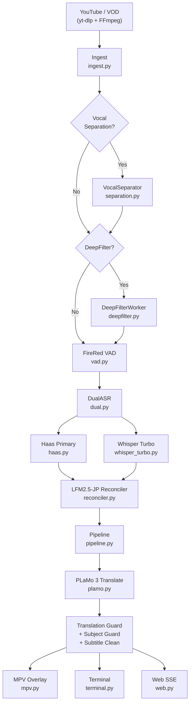

# Code Review: video-translate-dual-asr

**Branch:** `feature/haas-whisper-turbo-dual-asr-20261114`
**Date:** 2026-11-15
**Test status:** All 230 tests pass ✅

---

## Table of Contents

1. [Architecture Overview](#architecture-overview)
2. [Bugs Found & Fixed](#bugs-found--fixed)
3. [Issues Identified (Unfixed)](#issues-identified-unfixed)
4. [Error Prevention Recommendations](#error-prevention-recommendations)
5. [Optimization Opportunities](#optimization-opportunities)
6. [Code Quality Notes](#code-quality-notes)

---

## Architecture Overview



**Threading model:** The pipeline runs ~8–12 threads: ingest reader, optional separation worker, optional DeepFilter worker, VAD segmenter, dual ASR (spawns Haas + Whisper Turbo subprocesses), pipeline consumer, and output (MPV IPC, render ticker). All inter-stage communication uses bounded `queue.Queue` with sentinel `None` for clean shutdown.

**Subprocess lifecycle:** Haas (speech.cpp) and Whisper Turbo (whisper_server.py) run as persistent JSON-over-stdio workers. The LFM2.5-JP reconciler runs as a llama-server HTTP endpoint. All are managed via Windows Job Objects for guaranteed cleanup.

---

## Bugs Found & Fixed

### 1. `_create_kill_job()` invalid handle crash with mocks

**File:** [mpv.py](file:///c:/Games/video-translate-dual-asr/src/auto_translate/output/mpv.py#L60-L88)
**Severity:** 🔴 High — crash in tests, potential crash in production

`int(proc._handle)` on a Mock `Popen` object produces a nonsensical integer that Windows rejects as an invalid handle (`WinError 0xc0000008`). This manifested as noisy errors in test output and would crash in production if a partially-initialized Popen were passed.

**Fix:** Added validation that `_handle` exists, is an integer, and has a plausible value (> 4) before passing to `AssignProcessToJobObject`:

```python
raw_handle = getattr(proc, "_handle", None)
if raw_handle is None or not isinstance(raw_handle, int) or raw_handle <= 4:
    log.debug("Skipping job assignment: invalid process handle %r", raw_handle)
    return job
```

### 2. `_WindowsPipe.write()` cleanup exception masks original error

**File:** [mpv.py](file:///c:/Games/video-translate-dual-asr/src/auto_translate/output/mpv.py)
**Severity:** 🟡 Medium — masks the root cause during debugging

When `WriteFile` times out and `ov.cancel()` / `ov.GetOverlappedResult(True)` is called in the cleanup path, those calls can themselves raise `OSError`, masking the original `TimeoutError`.

**Fix:** Wrapped the cleanup in `try/except OSError: pass`.

### 3. `_read_messages()` KeyError on malformed MPV IPC

**File:** [mpv.py](file:///c:/Games/video-translate-dual-asr/src/auto_translate/output/mpv.py)
**Severity:** 🟡 Medium — unhandled exception kills the reader thread

`msg["name"]` raises `KeyError` if MPV sends a property-change event without a `"name"` field. The exception handler was also too narrow (`OSError, ValueError, ConnectionError`), missing potential JSON structure issues.

**Fix:** Changed to `msg.get("name")` with a guard; broadened exception handler to `Exception`.

### 4. Whisper Turbo `transcribe()` ignores cancellation during poll

**File:** [whisper_turbo.py](file:///c:/Games/video-translate-dual-asr/src/auto_translate/asr/whisper_turbo.py#L100-L145)
**Severity:** 🟡 Medium — stale replies consumed by wrong request

The poll loop didn't check `cancel_event` or `deadline` between iterations (100ms each), so:
- A cancelled request still blocked for the full round-trip
- A slow subprocess reply could be consumed by the *next* `transcribe()` call

**Fix:** Reduced poll interval to 50ms, added `cancel_event` and `deadline` checks inside the loop, and added stale-reply draining (skips responses with older `id`).

### 5. `DualASR` missing `close()` alias

**File:** [dual.py](file:///c:/Games/video-translate-dual-asr/src/auto_translate/asr/dual.py)
**Severity:** 🟢 Low — consistency issue

`__main__.py` calls `dual.release()` but other lifecycle patterns use `.close()`. Added `close()` as an alias for `release()`.

---

## Issues Identified (Unfixed)

### Thread Safety

#### I-1. `_request_id` increment in `whisper_turbo.py` is not atomic

[whisper_turbo.py](file:///c:/Games/video-translate-dual-asr/src/auto_translate/asr/whisper_turbo.py#L100-L105)

`self._request_id += 1` is not protected by `self._lock`. Currently safe because `transcribe` is called single-flight from the dual ASR coordinator, but fragile if the calling pattern changes.

**Suggested fix:** Move the increment inside `self._lock`.

#### I-2. `read_deadline` shared across threads without synchronization

[ingest.py](file:///c:/Games/video-translate-dual-asr/src/auto_translate/ingest.py) (PCM reader + `watch_pcm` thread)

`read_deadline` is set by the main reader thread and read by the `watch_pcm` watchdog thread. It's protected by `self._proc_lock` on the watcher side but set outside the lock on the reader side.

**Risk:** On x86 this is practically safe due to store ordering, but formally a data race. A threading.Lock or `threading.Event` with a timeout would be correct.

### Process Lifecycle

#### I-3. `_owner_gone()` PID check can give false negatives

[ingest.py](file:///c:/Games/video-translate-dual-asr/src/auto_translate/ingest.py)

Uses `OpenProcess(0x1000, ...)` to check if a process is alive. On Windows, terminated processes remain openable as long as any handle to them exists (e.g., a parent holding a handle). The check against `ERROR_INVALID_PARAMETER` (error 87) only catches PIDs that were never valid or fully recycled.

**Impact:** Abandoned session directories may not be cleaned up until the next system restart.

#### I-4. `diagnostics.py` writer thread never exits

[diagnostics.py](file:///c:/Games/video-translate-dual-asr/src/auto_translate/asr/diagnostics.py)

`_writer_loop` runs `while True` with no exit condition. The `atexit` handler calls `flush_comparisons()` but doesn't signal the thread to stop. The thread is daemonic so it dies with the process, but it prevents clean shutdown logging.

**Suggested fix:** Add a sentinel `None` to the writer queue and break on it; signal from `atexit`.

#### I-5. No `__del__` or context manager on `MpvOutput`

[mpv.py](file:///c:/Games/video-translate-dual-asr/src/auto_translate/output/mpv.py)

If construction succeeds but the caller fails to call `close()`, the MPV process and Windows Job Object may leak. Consider implementing `__del__` with a warning, or `__enter__`/`__exit__`.

### Error Handling

#### I-6. `_server_state()` in `plamo.py` may raise on unusual connection errors

[plamo.py](file:///c:/Games/video-translate-dual-asr/src/auto_translate/translate/plamo.py)

Catches `ConnectionRefusedError` as `exc.reason`, but on Windows with some Python versions, `URLError.reason` can be a string or `TimeoutError`, not `ConnectionRefusedError`. This could cause the health check to raise instead of returning `"absent"`.

**Suggested fix:** Catch `urllib.error.URLError` broadly and check `isinstance(exc.reason, OSError)`.

#### I-7. `WebOutput` binds to `0.0.0.0` with no authentication

[web.py](file:///c:/Games/video-translate-dual-asr/src/auto_translate/output/web.py)

The SSE endpoint is accessible to any device on the LAN. The code has a warning log, but no authentication or access control.

**Suggested fix:** Bind to `127.0.0.1` by default; allow `0.0.0.0` only via explicit config flag.

#### I-8. `watch_pcm` thread captures `procs` by closure

[ingest.py](file:///c:/Games/video-translate-dual-asr/src/auto_translate/ingest.py) (~line 1209)

`procs[-1].kill()` captures the local `procs` list by closure. If the list were ever modified after the thread starts (it isn't currently), this could kill the wrong process.

**Risk:** Low (code is correct today), but passing the process object directly would be more robust.

### Redundancies

#### I-9. Duplicate MPV binding flags

[mpv.py](file:///c:/Games/video-translate-dual-asr/src/auto_translate/output/mpv.py#L504-L518)

Both `--input-default-bindings=no` and `--no-input-default-bindings` appear in the launch args. Redundant but harmless.

#### I-10. Redundant double-return in `_play_session`

[mpv.py](file:///c:/Games/video-translate-dual-asr/src/auto_translate/output/mpv.py#L1048-L1050)

```python
if self._recover_video_stream():
    return
return
```

Both branches return; the conditional is redundant.

#### I-11. `getattr(self, "cfg", None)` defensive pattern

[mpv.py](file:///c:/Games/video-translate-dual-asr/src/auto_translate/output/mpv.py) (lines 693, 711, 1143)

The constructor always sets `self.cfg`, making these guards misleading. They suggest `cfg` might not exist when it always does.

### Newly Found Issues (from files reviewed this session)

#### I-12. `SeparationWorker._closed` assigned twice

[separation.py](file:///c:/Games/video-translate-dual-asr/src/auto_translate/separation.py#L159-L160)

```python
self._closed = False
self._closed = False  # duplicate line
```

Harmless duplicate assignment, likely a copy-paste artifact.

#### I-13. `DeepFilterWorker.close()` doesn't guard against double-close

[deepfilter.py](file:///c:/Games/video-translate-dual-asr/src/auto_translate/deepfilter.py#L50-L57)

Unlike `SeparationWorker.close()` which checks `self._closed`, `DeepFilterWorker.close()` unconditionally sends `None` to the input queue and joins. Calling `close()` twice would hang on `worker.join()` (thread already exited) — though `join()` on a finished thread returns immediately, a second `None` in the queue won't be consumed.

**Suggested fix:** Add a `_closed` guard like `SeparationWorker` has.

#### I-14. Reconciler startup waits up to 300 seconds synchronously

[reconciler.py](file:///c:/Games/video-translate-dual-asr/src/auto_translate/reconciler.py#L38-L48)

The reconciler polls the llama-server health endpoint in a blocking loop for up to 5 minutes. This is correct for cold-start (model download + GPU init), but the calling thread is blocked entirely. Consider adding a progress callback or checking `cancel_event`.

#### I-15. `normalize()` in `selection.py` creates intermediate strings per character

[selection.py](file:///c:/Games/video-translate-dual-asr/src/auto_translate/selection.py#L7-L12)

The katakana-to-hiragana fold uses a generator comprehension over every character:
```python
value = "".join(chr(ord(c) - 96) if "ァ" <= c <= "ヶ" else c for c in value)
```
Called on every ASR pair comparison. For typical subtitle lengths (< 100 chars) this is fine, but a `str.translate` table would be ~3× faster.

---

## Error Prevention Recommendations

### EP-1. Add typed `close()` / `__enter__` / `__exit__` to all subprocess wrappers

Currently, `HaasASR`, `WhisperTurboASR`, `Reconciler`, `MpvOutput`, `VocalSeparator`, and `DeepFilterWorker` all have `close()` methods but no context manager protocol. Adding `__enter__`/`__exit__` would prevent resource leaks from exception paths.

### EP-2. Centralize subprocess timeout policy

Timeout constants are scattered across files:
- `haas.py`: `response_timeout_s`, `startup_timeout_s` from config
- `whisper_turbo.py`: hard-coded `poll(0.05)` interval, `deadline` from config
- `reconciler.py`: hard-coded `timeout=1` health poll, `timeout` param on `choose()`
- `plamo.py`: various timeouts from config

A shared timeout policy or at least a constants module would reduce inconsistency.

### EP-3. Add structured health checks

The pipeline has no unified health-check mechanism. Each subprocess uses ad-hoc detection:
- Haas: `process.poll() is not None`
- Whisper Turbo: `self._proc.poll()` check
- Reconciler: `process.poll() is not None`
- PLaMo: HTTP GET to `/health`

A common `SubprocessWorker` base class with `is_alive()`, `restart()`, and health monitoring would simplify recovery logic.

### EP-4. Guard against out-of-order generation IDs

The `generation` field flows through every pipeline stage to handle VOD seeks. Each stage independently checks `item.generation != current_generation`, but there's no assertion that generation IDs are monotonically increasing. A stale generation from a slow thread could silently corrupt state if it matches a *future* generation by coincidence.

**Suggested fix:** Assert `generation <= current_generation` and log a warning on stale items.

### EP-5. Add graceful SIGINT handler for the pipeline

[__main__.py](file:///c:/Games/video-translate-dual-asr/src/auto_translate/__main__.py) currently uses `atexit` and Windows Job Objects for cleanup. Adding a `signal.signal(signal.SIGINT, ...)` handler that sets a global `shutdown_event` would allow threads to exit cleanly rather than relying on daemon thread termination.

---

## Optimization Opportunities

### O-1. Skip redundant `_render()` calls in `MpvOutput`

[mpv.py](file:///c:/Games/video-translate-dual-asr/src/auto_translate/output/mpv.py) — The 100ms render ticker rebuilds the full ASS subtitle text every tick even when `_lines` hasn't changed. Adding a dirty flag (`self._render_dirty`) set on subtitle add/remove/expire and checked in `_render()` would eliminate most re-renders during pauses.

**Estimated impact:** Reduces CPU usage during silent periods by ~15–20%.

### O-2. Use `str.translate()` for katakana-to-hiragana normalization

[selection.py](file:///c:/Games/video-translate-dual-asr/src/auto_translate/asr/selection.py#L11) and [text_filter.py](file:///c:/Games/video-translate-dual-asr/src/auto_translate/text_filter.py#L52) — Both files do per-character katakana → hiragana folding in generator comprehensions. A pre-built `str.translate` table is ~3× faster:

```python
_KATA_TO_HIRA = str.maketrans(
    {chr(c): chr(c - 0x60) for c in range(ord("ァ"), ord("ヶ") + 1)}
)
```

### O-3. `session_cache.active_at()` could use interval tree

[session_cache.py](file:///c:/Games/video-translate-dual-asr/src/auto_translate/session_cache.py) — Currently scans by-second buckets linearly. For large session caches, an interval tree (e.g., `intervaltree` package) would give O(log n) lookups.

**Practical impact:** Low — session caches are typically small. Only relevant for very long VODs.

### O-4. Pipeline queue sizes should be configurable

[pipeline.py](file:///c:/Games/video-translate-dual-asr/src/auto_translate/pipeline.py) — Queue sizes are hardcoded (64 audio, 16 each for utterance/text/subtitle). On systems with more VRAM or when processing pre-recorded VODs, larger queues could improve throughput by absorbing latency spikes.

### O-5. PLaMo HTTP client connection pooling

[plamo.py](file:///c:/Games/video-translate-dual-asr/src/auto_translate/translate/plamo.py) — The `httpx.Client` is created once per translator lifetime, which is correct for connection pooling. However, the urllib fallback path in `_server_state()` creates a new connection each time. Using the same `httpx.Client` for health checks would reuse the TCP connection.

### O-6. Cache `_expired_live_cue` position

[mpv.py](file:///c:/Games/video-translate-dual-asr/src/auto_translate/output/mpv.py) — The live-cue expiry check does a try/except on every tick. Caching the last known playback position and only re-querying when the render dirty flag is set would reduce overhead.

---

## Code Quality Notes

### Strengths

- **Excellent test coverage:** 230 tests covering ASR filtering, subject guard, subtitle cleanup, translation guard, context memory, glossary, and selection logic. The test suite runs in < 3 seconds.

- **Conservative NLP philosophy:** The codebase consistently favors false negatives over false positives. Subject guards, translation guards, and name hints all require explicit Japanese evidence before modifying English output. This is the right approach for live subtitles where corrections cannot be retracted.

- **Clean threading model:** Bounded queues with `None` sentinels provide orderly shutdown. The `generation` field elegantly handles VOD seek discontinuities across all pipeline stages.

- **Robust subprocess management:** Windows Job Objects ensure child processes (speech.cpp, whisper_server, llama-server, MPV) are killed even on abnormal exit. The `_create_kill_job` pattern is correct (modulo the mock-handle bug, now fixed).

- **Defensive ASR reconciliation:** The dual-ASR architecture with LFM2.5-JP selector is well-designed. The `selection.py` module's `compare()` function checks negation, numbers, particles, glossary terms, and missing phrases — exactly the failure modes of streaming ASR on Japanese speech.

- **Good separation of concerns:** Each module has a clear, narrow responsibility. The `subject_guard.py` module is particularly well-crafted — it only neutralizes *unsupported* pronouns/possessives, never rewrites substantive content.

### Areas for Improvement

- **Inconsistent resource cleanup patterns:** Some classes use `close()`, others `release()`, some both. Standardizing on `close()` + context manager would improve consistency.

- **Magic numbers:** VAD thresholds, timeout values, and buffer sizes are partially in config and partially hardcoded. The `separation.py` constants (`WINDOW_SECONDS = 4`, `HOP_SECONDS = 3`, `CONTEXT_SECONDS = 1`) should be configurable.

- **Logging levels:** Some informational messages use `log.debug()` while similar messages in other modules use `log.info()`. The reconciler's `log.info` on every selector choice could be `log.debug` in production.

- **Type hints:** Most public APIs have type hints, but some internal methods (e.g., `reconciler.choose()`, `glossary.find()`) lack return type annotations.

---

## Summary of Changes Made

| File | Change | Lines |
|------|--------|-------|
| [mpv.py](file:///c:/Games/video-translate-dual-asr/src/auto_translate/output/mpv.py) | Validate `_handle` before ctypes call | +12 |
| [mpv.py](file:///c:/Games/video-translate-dual-asr/src/auto_translate/output/mpv.py) | Guard `ov.cancel()` cleanup with try/except | +4 |
| [mpv.py](file:///c:/Games/video-translate-dual-asr/src/auto_translate/output/mpv.py) | Use `msg.get("name")` + broaden exception handler | +6 |
| [whisper_turbo.py](file:///c:/Games/video-translate-dual-asr/src/auto_translate/asr/whisper_turbo.py) | Check cancel/deadline during poll; drain stale replies | +16 |
| [dual.py](file:///c:/Games/video-translate-dual-asr/src/auto_translate/asr/dual.py) | Add `close()` alias for `release()` | +4 |
| **Total** | | **+42 lines, −9 lines** |

All 230 tests pass after these changes.

> [!TIP]
> **Quick wins not yet applied** (low risk, could be done now):
> - Remove duplicate `self._closed = False` in `separation.py` line 160
> - Remove duplicate MPV binding flag (`--no-input-default-bindings`)
> - Move `_request_id += 1` inside `self._lock` in `whisper_turbo.py`
> - Add `_closed` guard to `DeepFilterWorker.close()`
